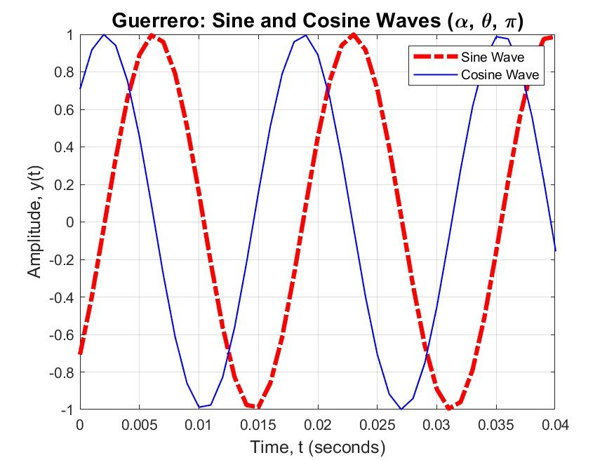
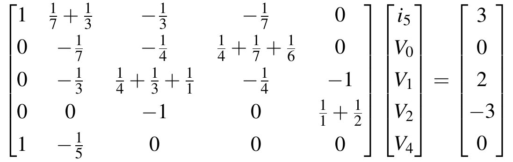
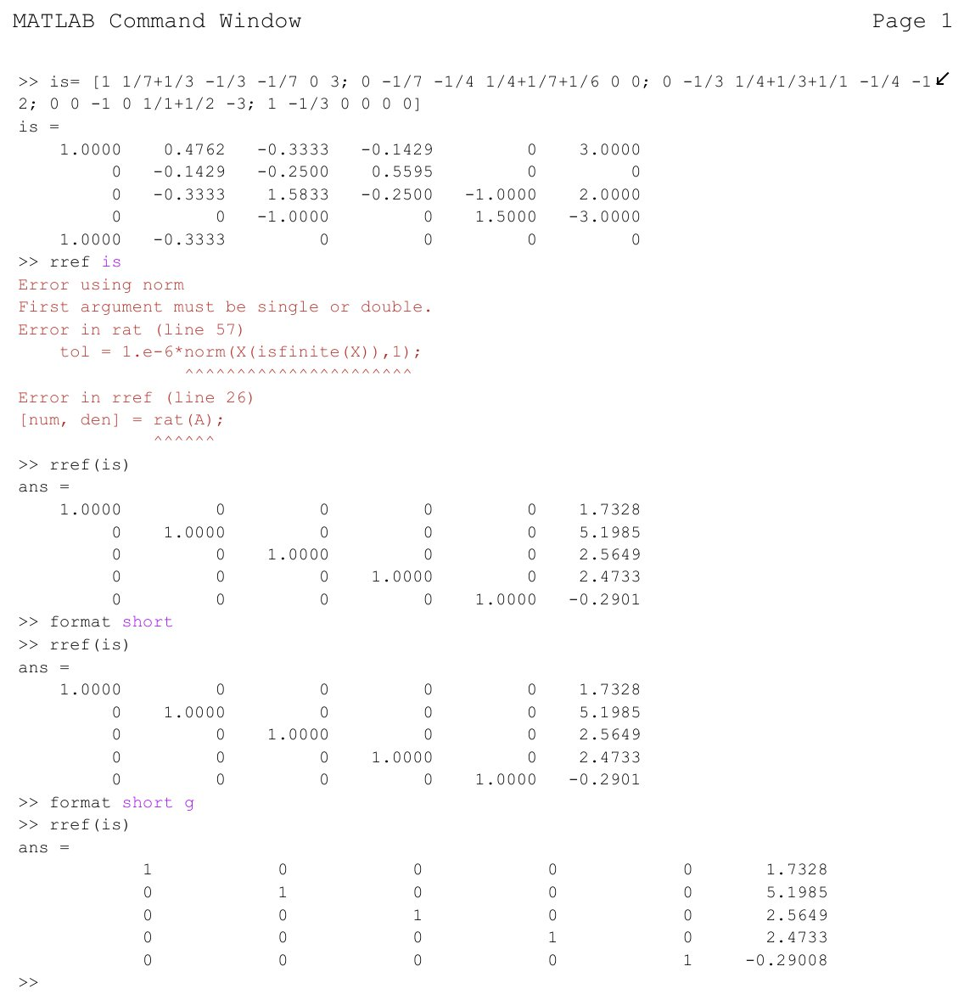

# MATLAB and Systems of Equations
**ECE 263 Linear Circuit Theory I · Lab 5 · Valparaiso University · Fall 2026**

> **Key result:** Nodal analysis solved with rref: i5 = 1.352 A

Used MATLAB as a calculator, matrix tool, plotter, and circuit solver.

## What I did

- Set up nodal analysis for the lab circuit as a five-unknown matrix equation and solved it with rref (i5 = 1.352 A).
- Plotted a 60 Hz sine and a phase-shifted cosine on one figure.
- Solved a 3 × 3 matrix equation on a handheld calculator (x = [2, −1, 3]).

## Report
- 📄 [Full report (PDF)](Guerrero_ECE263_Lab5_MATLAB_Systems_of_Equations.pdf)

## Figures

### Waveform: 60 Hz sine and cosine plotted in MATLAB

### Chart: Nodal-analysis matrix equation solved with rref

### Chart: MATLAB rref output (i5 = 1.352 A)

## Tools
MATLAB, linear algebra, nodal analysis

---

**Austin Guerrero** · Electrical Engineering, Valparaiso University (Christ Honors College)  
Portfolio: [austinguerrero.dev](https://austinguerrero.dev) · LinkedIn: [in/guerrero-austin](https://www.linkedin.com/in/guerrero-austin)
